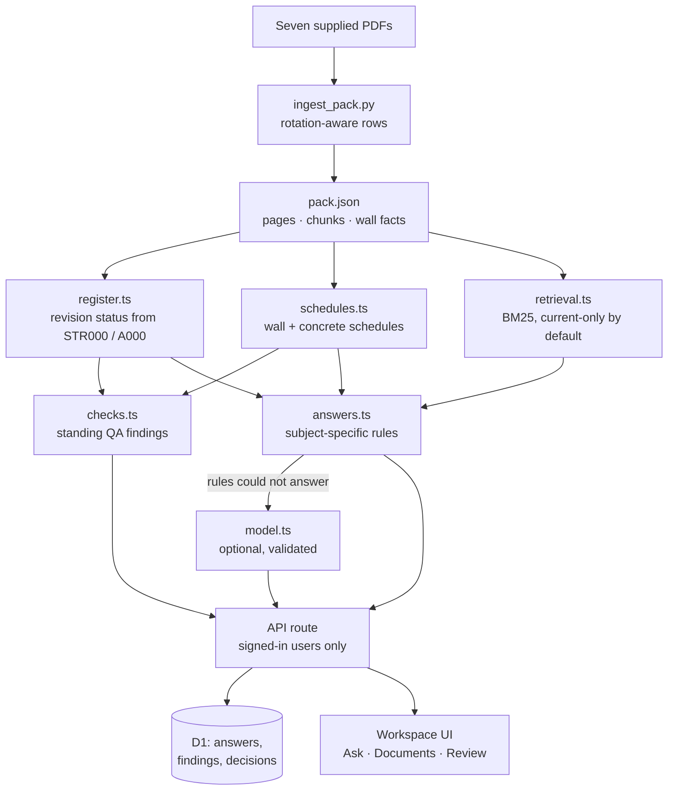

# Architecture

See `technical-explanation.md` for the reasoning behind each part.

## Flow

## Modules

| Path | Responsibility |
|---|---|
| `scripts/ingest_pack.py` | Offline PDF ingestion: text rows, sheet numbers, sheet revisions, wall facts, chunks, previews, SHA-256 |
| `lib/corpus.ts` | Loads the pack, applies register-derived status, builds citations from page records |
| `lib/register.ts` | Parses drawing registers, cross-checks title blocks and labels, orders revisions |
| `lib/schedules.ts` | Wall-schedule rows (system, thickness, reinforcement, f′c) and the Concrete Quality schedule |
| `lib/checks.ts` | Standing findings: dimension and reinforcement conflicts, legends, certificate, coordination, evidence gaps, revision issues |
| `lib/retrieval.ts` | BM25 retrieval over page-bounded chunks |
| `lib/answers.ts` | Reads the question's subject and scope; answers only when that subject is found; otherwise abstains |
| `lib/model.ts` | Optional model call with citation and number validation |
| `lib/storage.ts` | D1 persistence, review transitions, optimistic concurrency, decision snapshots, evidence-drift flag |
| `app/api/[action]/route.ts` | Authenticated API with body limits and validation |
| `app/workspace.tsx`, `components/qa/*` | UI: ask, document register, engineer review, evidence side panel |

## Data model (D1 / SQLite)

- `answers(id, question, payload, actor, created_at)`: every question and full answer with citations.
- `findings(id, payload, actor, created_at)`: questions escalated to review. Standing findings are computed, not stored.
- `decisions(id, finding_id, version, status, comment, reviewer, created_at, snapshot)` with a unique index on `(finding_id, version)`. Append-only; the newest version is the current status.

## Answer statuses

| Status | Meaning |
|---|---|
| Supported by sources | Direct answer from cited current evidence |
| Conflicting evidence | Current sources disagree; both shown; no value selected |
| Cannot be verified | Evidence missing; related excerpts and missing items listed |
| Engineer confirmation needed | Evidence exists but needs interpretation |
| Clarify the question | The question could mean different items with different values |
